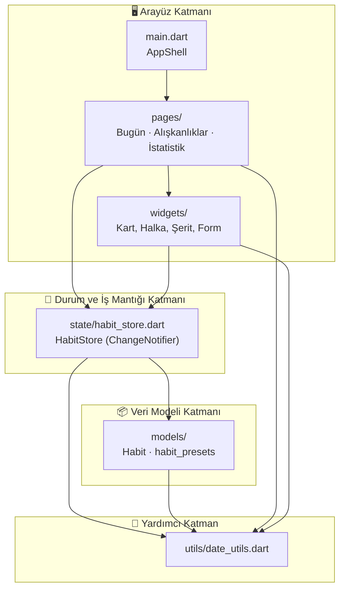
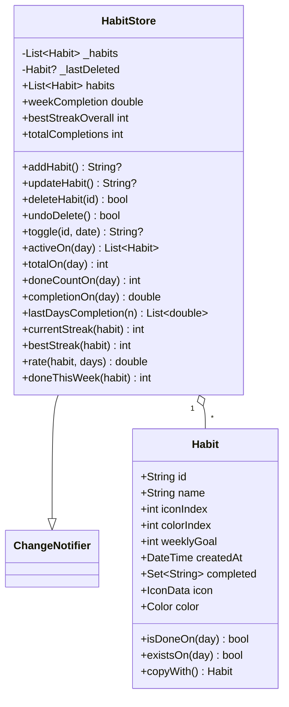
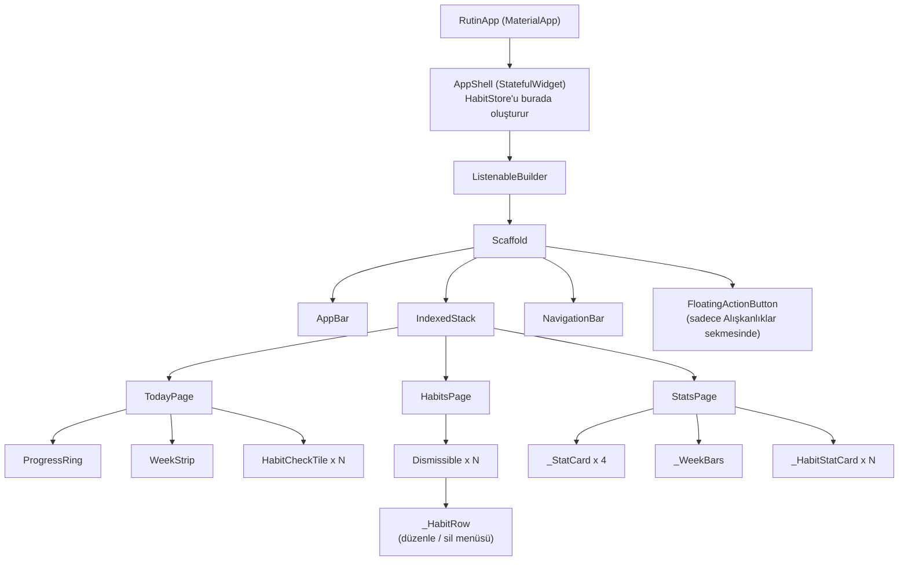
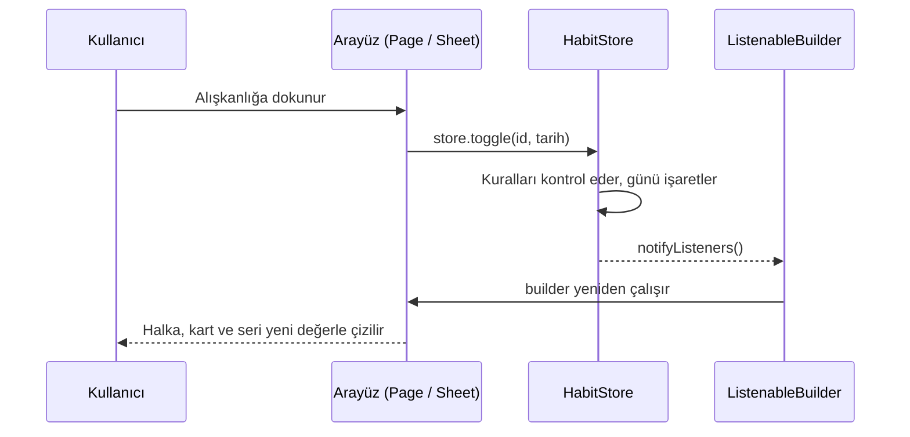
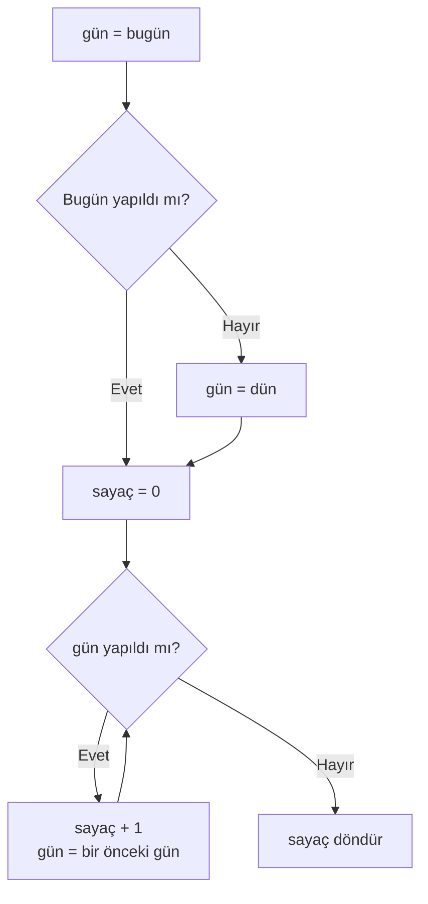
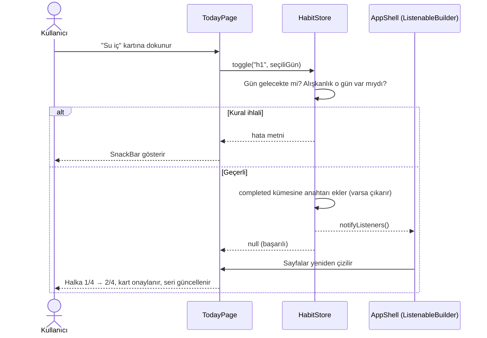
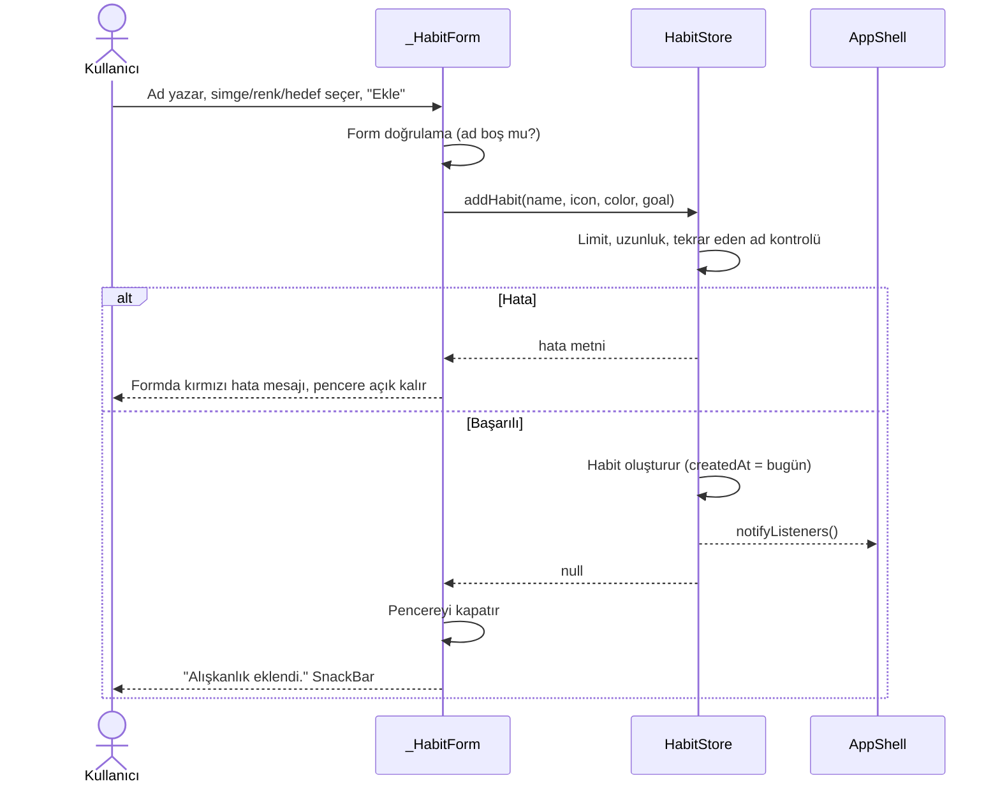
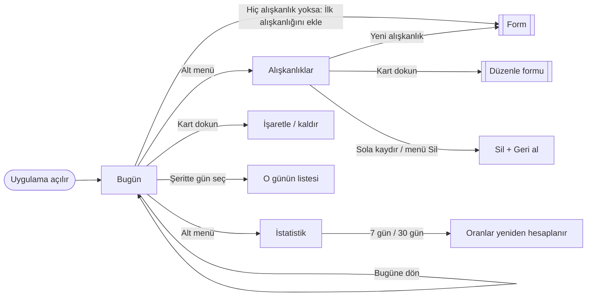

# 🔥 Rutin — Flutter Alışkanlık Takip Uygulaması Dokümantasyonu

> Günlük alışkanlıklarını işaretle, serilerini koru, ilerlemeni istatistiklerle izle.
> Üç sayfa, sıfır ek paket, tamamen çalışan bir Flutter örneği.

---

## İçindekiler

1. [Projeye Genel Bakış](#1-projeye-genel-bakış)
2. [Özellikler](#2-özellikler)
3. [Kurulum ve Çalıştırma](#3-kurulum-ve-çalıştırma)
4. [Klasör Yapısı](#4-klasör-yapısı)
5. [Mimari](#5-mimari)
6. [Dosya Dosya Açıklama](#6-dosya-dosya-açıklama)
7. [Algoritmalar: Seri, Oran ve Hafta Hesapları](#7-algoritmalar-seri-oran-ve-hafta-hesapları)
8. [Veri Akışı Örnekleri](#8-veri-akışı-örnekleri)
9. [İş Kuralları ve Doğrulamalar](#9-iş-kuralları-ve-doğrulamalar)
10. [Ekranlar ve Kullanıcı Akışı](#10-ekranlar-ve-kullanıcı-akışı)
11. [Tasarım Kararları (Neden Böyle Yaptık?)](#11-tasarım-kararları-neden-böyle-yaptık)
12. [Bilinen Sınırlamalar](#12-bilinen-sınırlamalar)
13. [Geliştirme Önerileri](#13-geliştirme-önerileri)
14. [Test Örneği](#14-test-örneği)
15. [Sözlük](#15-sözlük)

---

## 1. Projeye Genel Bakış

**Rutin**, kullanıcının günlük alışkanlıklarını (su içmek, kitap okumak, yürüyüş yapmak vb.) tanımlayıp her gün işaretlemesini; kesintisiz **seri (streak)** oluşturmasını ve ilerlemesini grafik ve oranlarla görmesini sağlayan bir mobil uygulamadır.

| Bilgi | Değer |
|---|---|
| Platform | Flutter (Android / iOS / Web / Masaüstü) |
| Dil | Dart 3 |
| Arayüz | Material 3 (turuncu tema) |
| Durum yönetimi | `ChangeNotifier` + `ListenableBuilder` (ek paket yok) |
| Dış bağımlılık | Yok (sadece Flutter SDK) |
| Veri kaynağı | Bellekte tutulan örnek (demo) veri |
| Sayfa sayısı | 3 (Bugün, Alışkanlıklar, İstatistik) |

**Temel fikir:** Bütün veri tek bir yerde (`HabitStore`) tutulur. Sayfalar yalnızca bu veriyi gösterir; kullanıcının isteklerini (işaretle, ekle, sil…) store'a iletir. Store veriyi güncelleyip herkese haber verir, ekranlar kendiliğinden yenilenir.

---

## 2. Özellikler

### 📅 Bugün sayfası
- Saate göre selamlama (Günaydın / İyi günler / İyi akşamlar / İyi geceler) ve uzun tarih
- **İlerleme halkası:** "3/4" gibi yapılan / toplam gösterimi ve yüzde, animasyonlu
- Duruma göre motivasyon mesajı ("Hadi başlayalım!", "2 alışkanlık kaldı", "Harika! Hepsi tamam 🎉")
- **7 günlük şerit:** Geçmiş günleri seçip o günün alışkanlıklarını işaretleyebilirsin. Hepsi tamamlanan günün altında yeşil nokta çıkar
- Alışkanlık kartına dokununca işaretlenir / işaret kalkar (animasyonlu onay dairesi)
- Her kartta 🔥 güncel seri bilgisi
- "Bugüne dön" kısayolu
- Hiç alışkanlık yoksa "İlk alışkanlığını ekle" düğmesi

### 📝 Alışkanlıklar sayfası
- Tüm alışkanlıkların listesi (haftalık hedef + güncel seri)
- **Yeni alışkanlık** düğmesi (yüzen buton)
- Kart üzerine dokunarak **düzenleme**
- **Sola kaydırarak silme** veya ⋮ menüsünden Düzenle / Sil
- Silince **"Geri al"** seçeneği

### 📊 İstatistik sayfası
- Özet kartları: alışkanlık sayısı, bu haftaki tamamlama %, en iyi seri, toplam yapılan
- **Son 7 gün çubuk grafiği** (dışarıdan paket kullanılmadan çizildi)
- **7 gün / 30 gün** seçici
- Alışkanlık bazında: tamamlama oranı çubuğu, güncel seri, en iyi seri, bu hafta (örn. `3/5`)

### Alışkanlık formu (ekleme / düzenleme)
- Ad (en fazla 30 karakter)
- 12 simge ve 6 renk seçimi (seçime göre canlı önizleme)
- Haftalık hedef kaydırıcısı (haftada 1–7 gün)

---

## 3. Kurulum ve Çalıştırma

### Gereksinimler
- Flutter SDK 3.x (Dart 3 ile birlikte gelir)
- Bir emülatör, fiziksel cihaz veya tarayıcı

### Adımlar

```bash
# 1. Yeni bir Flutter projesi oluştur
flutter create rutin
cd rutin

# 2. Verilen lib/ klasörünün içeriğini projedeki lib/ klasörüne kopyala
#    (varsayılan main.dart'ın üzerine yazılır)

# 3. Çalıştır
flutter run
```

> **Not:** `pubspec.yaml` içine ek paket eklemeye gerek yoktur.

---

## 4. Klasör Yapısı

```
lib/
├── main.dart                        ← Giriş noktası ve ana iskelet (AppShell)
│
├── models/                          ← Veri şablonları
│   ├── habit.dart                   ← Habit: bir alışkanlık ve yapılan günleri
│   └── habit_presets.dart           ← Seçilebilir simge ve renk listeleri
│
├── state/                           ← Uygulamanın "beyni"
│   └── habit_store.dart             ← HabitStore: veri, iş kuralları, istatistikler
│
├── utils/                           ← Yardımcı fonksiyonlar
│   └── date_utils.dart              ← Gün/tarih işlemleri ve Türkçe tarih metinleri
│
├── pages/                           ← Üç ana ekran
│   ├── today_page.dart              ← Bugün
│   ├── habits_page.dart             ← Alışkanlıklar
│   └── stats_page.dart              ← İstatistik
│
└── widgets/                         ← Tekrar kullanılan arayüz parçaları
    ├── habit_check_tile.dart        ← İşaretlenebilir alışkanlık kartı
    ├── habit_form_sheet.dart        ← Ekleme/düzenleme alt penceresi
    ├── progress_ring.dart           ← Animasyonlu daire ilerleme göstergesi
    └── week_strip.dart              ← 7 günlük gün seçici şerit
```

**Okuma sırası önerisi:**
`utils/date_utils.dart` → `models/` → `state/habit_store.dart` → `widgets/` → `pages/` → `main.dart`

---

## 5. Mimari

Proje, birbirinden net ayrılmış **4 katmandan** oluşur. Her katman yalnızca altındaki katmanı bilir.

### 5.1 Katmanlı yapı



| Katman | Sorumluluk | Yapmaması gereken |
|---|---|---|
| **UI** (`main`, `pages`, `widgets`) | Ekranı çizmek, kullanıcı girişini almak | Seri hesaplamak, kural uygulamak |
| **State** (`HabitStore`) | Veriyi tutmak, kuralları uygulamak, istatistik hesaplamak, değişimi duyurmak | Widget çizmek |
| **Model** (`Habit`) | Verinin şeklini tanımlamak | Uygulama durumunu değiştirmek |
| **Utils** (`date_utils`) | Tarih işlemleri | Uygulama durumuna dokunmak |

### 5.2 Sınıf ilişkileri



### 5.3 Widget ağacı



### 5.4 Durum yönetimi nasıl çalışıyor?



1. `HabitStore`, `ChangeNotifier`'dan türer; veri değişince `notifyListeners()` çağırır.
2. `AppShell` içindeki `ListenableBuilder` store'u dinler ve her değişimde yeniden çizer.
3. Sayfalar store'u parametre olarak alır ve doğrudan okur. Bu yüzden bir sayfada yapılan değişiklik **diğer sayfalara anında yansır** (örn. Bugün'de işaretleyince İstatistik'teki yüzdeler değişir).

**Sayfa içi durum nerede tutulur?** Yalnızca arayüzü ilgilendiren geçici tercihler, ilgili sayfanın kendi `State`'indedir:

| Durum | Nerede | Neden |
|---|---|---|
| Bugün sayfasında seçili gün | `_TodayPageState._selected` | Sadece o ekranı ilgilendirir, verinin parçası değil |
| İstatistikte 7/30 gün seçimi | `_StatsPageState._rangeDays` | Sadece görünüm tercihi |
| Form alanları (ad, simge, renk, hedef) | `_HabitFormState` | Kaydedilene kadar geçicidir |
| Alışkanlıklar, tamamlanan günler | `HabitStore` | Uygulamanın gerçek verisi |

**Neden `IndexedStack`?** Üç sayfa da bellekte yaşar; sekmeler arasında gezinince Bugün sayfasında seçtiğin gün gibi durumlar kaybolmaz.

---

## 6. Dosya Dosya Açıklama

### 6.1 `main.dart`
| Sınıf | Görev |
|---|---|
| `RutinApp` | `MaterialApp`'i kurar: turuncu Material 3 teması, krem arka plan, ana sayfa |
| `AppShell` | İskelet. `HabitStore`'u **oluşturur ve yok eder** (`initState`/`dispose`), AppBar'ı, alt gezinmeyi ve yalnızca Alışkanlıklar sekmesinde görünen yüzen butonu yönetir |

### 6.2 `models/habit.dart` — `Habit`

| Alan | Tür | Anlamı |
|---|---|---|
| `id` | String | Benzersiz kimlik (`h1`, `h2`…) |
| `name` | String | Alışkanlık adı |
| `iconIndex` | int | `habitIcons` listesindeki sıra |
| `colorIndex` | int | `habitColors` listesindeki sıra |
| `weeklyGoal` | int | Haftalık hedef (1–7 gün) |
| `createdAt` | DateTime | Oluşturulma günü (saat yok) |
| `completed` | Set\<String\> | Yapılan günlerin anahtarları (`"2026-10-16"`) |

| Üye | Ne yapar |
|---|---|
| `icon`, `color` | Sıra numarasından gerçek ikon / rengi getirir |
| `isDoneOn(day)` | O gün yapıldı mı? |
| `existsOn(day)` | O gün alışkanlık zaten var mıydı? (`day >= createdAt`) |
| `copyWith(...)` | Değişen alanlarla yeni kopya üretir (model değiştirilemez) |

**Neden `Set<String>` ve tarih anahtarı?**
- `Set` içinde arama çok hızlıdır (`contains`) ve aynı gün iki kez eklenemez.
- `DateTime` yerine `"yyyy-MM-dd"` metni kullanmak **saat/saat dilimi karışıklığını** ortadan kaldırır: "16 Ekim 09:00" ile "16 Ekim 21:30" aynı gün sayılır.
- İleride JSON'a kaydetmek ve veritabanına yazmak çok kolaylaşır.

### 6.3 `models/habit_presets.dart`
12 simge (su damlası, koşu, kitap, meditasyon, uyku, spor, yemek, kod, fırça, müzik, birikim, spa) ve 6 renk (turuncu, mavi, yeşil, mor, pembe, turkuaz). `Habit` yalnızca **sıra numarasını** saklar; böylece veri sade ve kaydedilebilir kalır.

### 6.4 `utils/date_utils.dart`

| Fonksiyon | Ne yapar | Örnek |
|---|---|---|
| `dateOnly(d)` | Saati atar | `16 Ekim 14:32` → `16 Ekim 00:00` |
| `today()` | Bugünün tarihi (saatsiz) | |
| `addDays(d, n)` | Güvenli gün ekleme/çıkarma | `addDays(31 Ekim, 1)` → `1 Kasım` |
| `sameDay(a, b)` | İki tarih aynı gün mü? | |
| `dateKey(d)` / `parseKey(s)` | Tarih ↔ `"2026-10-16"` | |
| `weekdayShort/Full(d)` | Türkçe gün adı | `Cum` / `Cuma` |
| `formatLongDate(d)` | Uzun tarih | `16 Ekim Cuma` |
| `startOfWeek(d)` | Haftanın başı (Pazartesi) | |
| `greeting()` | Saate göre selamlama | `Günaydın` |

> `addDays` içinde `DateTime(y, m, d + n)` kullanılır. Dart ay taşmalarını (32 Ekim → 1 Kasım) kendisi düzeltir; `Duration(days: n)` eklemek ise yaz/kış saati geçişinde bir günü atlayabilirdi.

### 6.5 `state/habit_store.dart` — Uygulamanın kalbi

**Yönetim metotları**

| Metot | Ne yapar | Hata durumları |
|---|---|---|
| `addHabit(...)` | Yeni alışkanlık ekler (`createdAt` = bugün) | Boş/uzun ad, aynı ad, geçersiz hedef, 20 sınırı |
| `updateHabit(id, ...)` | Ad, simge, renk, hedefi günceller; **geçmişi korur** | Alışkanlık bulunamadı; `addHabit` ile aynı ad / hedef doğrulamaları (kendi adı hariç) |
| `deleteHabit(id)` | Siler, "geri al" için hatırlar | — |
| `undoDelete()` | Son silineni eski sırasına geri koyar | Silinen yoksa `false` |
| `toggle(id, date)` | Günü işaretler / işareti kaldırır | Gelecek gün, alışkanlık yok, alışkanlık o gün henüz yoktu |

**Sorgu / istatistik metotları**

| Metot | Döndürdüğü |
|---|---|
| `activeOn(day)` | O gün var olan alışkanlıklar |
| `totalOn(day)` / `doneCountOn(day)` | O günün toplam / yapılan sayısı |
| `completionOn(day)` | O günün oranı (0–1) |
| `lastDaysCompletion(n)` | Son n günün oranları (grafik için) |
| `currentStreak(h)` / `bestStreak(h)` | Güncel / en iyi seri |
| `rate(h, days)` | Son n gündeki tamamlama oranı |
| `doneThisWeek(h)` | Bu hafta kaç gün yapıldı |
| `weekCompletion` | Bu haftaki genel oran |
| `bestStreakOverall`, `totalCompletions` | Özet kartları için |

**Hata dönüş kuralı:** İşlem metotları `String?` döndürür → `null` = başarılı, metin = kullanıcıya gösterilecek hata mesajı. Arayüz `try/catch` yerine `if (error != null)` yazar.

**Başlangıç (demo) verisi:** İstatistikler boş görünmesin diye 4 alışkanlık yaklaşık 45 günlük geçmişle gelir:

| Alışkanlık | Hedef | Geçmiş | Bugünkü durum |
|---|---|---|---|
| Su iç (2 litre) | 7 gün | 45 gün | Yapılmadı |
| 20 sayfa kitap oku | 5 gün | 45 gün | Yapıldı |
| 30 dk yürüyüş | 4 gün | 45 gün | Yapılmadı |
| Meditasyon | 3 gün | 10 gün (yeni) | Yapılmadı |

### 6.6 `widgets/`

| Dosya | Bileşen | Görev |
|---|---|---|
| `progress_ring.dart` | `ProgressRing` | `TweenAnimationBuilder` ile değeri yumuşakça değişen halka; ortasına istenen widget konur |
| `week_strip.dart` | `WeekStrip`, `_DayCell` | Son 7 günü gösterir, seçileni vurgular, bugünü çerçeveler, tamamlanan günün altına yeşil nokta koyar |
| `habit_check_tile.dart` | `HabitCheckTile` | Bugün sayfasındaki kart: simge, ad (yapılınca üstü çizilir), 🔥 seri, animasyonlu onay dairesi |
| `habit_form_sheet.dart` | `showHabitFormSheet`, `_HabitForm` | Ekleme **ve** düzenleme için tek form; `habit` verilirse düzenleme modu |

### 6.7 `pages/`

**`today_page.dart` — `TodayPage` (StatefulWidget)**
Seçili gün (`_selected`) bu sayfanın kendi durumudur. Seçili güne göre `store.activeOn()` ile alışkanlıkları alır, yapılan sayısından halka değerini ve mesajı hesaplar. "Alışkanlık ekle" davranışını `onAddHabit` geri çağırımıyla dışarıdan alır.

**`habits_page.dart` — `HabitsPage` (StatelessWidget)**
Liste, `Dismissible` ile sola kaydırarak silme, `PopupMenuButton` ile düzenle/sil, silince `SnackBar` içinde **Geri al** (`store.undoDelete`).

**`stats_page.dart` — `StatsPage` (StatefulWidget)**
7/30 gün seçimi sayfanın kendi durumudur. Özet kartları, `_WeekBars` (Container'larla çizilen çubuk grafik) ve alışkanlık başına `_HabitStatCard` içerir.

---

## 7. Algoritmalar: Seri, Oran ve Hafta Hesapları

### 7.1 Güncel seri (`currentStreak`)

**Kural:** Bugün henüz işaretlenmediyse seri **bozulmuş sayılmaz**; gün bitene kadar şansın var. Bu yüzden sayım bugün yapılmadıysa dünden başlar.



**Örnek 1 — bugün henüz yapılmadı:** Son günler `Pzt ✓, Sal ✓, Çar ✓, Per ✓, Cum (bugün) ✗`.
Bugün yapılmadığı için sayım dünden (Per) başlar: Per, Çar, Sal, Pzt → seri **4**. Seri hâlâ canlıdır; bugün işaretlenirse **5** olur.

**Örnek 2 — dün yapılmadı:** `Çar ✓, Per ✗, Cum (bugün) ✓`.
Bugün yapıldığı için sayım bugünden başlar: Cum ✓ (1), Per ✗ → durur → seri **1**.

**Örnek 3 — seri koptu:** `Çar ✓, Per ✗, Cum (bugün) ✗`.
Bugün yapılmadığı için dünden başlanır; Per yapılmamış → seri **0**.

---

### 7.2 En iyi seri (`bestStreak`)

1. Tamamlanan günlerin anahtarlarını tarihe çevir ve **sırala**.
2. İlk günden başla: `en iyi = 1`, `mevcut = 1`.
3. Her gün için bir önceki günün **ertesi** ise `mevcut++`, değilse `mevcut = 1`.
4. `mevcut` en iyiyi geçerse güncelle.

```
Günler:  1  2  3  _  5  6  _  8
Mevcut:  1  2  3  1  2  1  1 ...      → en iyi = 3
```

### 7.3 Tamamlama oranı (`rate`)

Son *N* gün içinde, **alışkanlık var olan** günler sayılır:

```
oran = yapılan gün sayısı ÷ (alışkanlığın var olduğu gün sayısı)
```

> Üç gün önce eklenen bir alışkanlık için "30 günlük oran" 30'a değil 4'e bölünür; aksi halde yeni alışkanlıklar haksız yere düşük görünürdü.

### 7.4 Bu hafta hesapları

- Hafta **Pazartesi** başlar (`startOfWeek`).
- `doneThisWeek(h)`: Pazartesi'den bugüne işaretli gün sayısı → "Hafta 3/5" gösterimi.
- `weekCompletion`: Pazartesi'den bugüne her günün `yapılan` ve `toplam` değerlerini toplar, `Σ yapılan ÷ Σ toplam` döndürür.

### 7.5 Günlük oran ve son 7 gün grafiği

- `completionOn(day) = yapılan ÷ o gün var olan alışkanlık sayısı`
- `lastDaysCompletion(7)` en eski günden bugüne 7 değer döndürür; `_WeekBars` her değeri `110 piksel × oran` yüksekliğinde bir çubuğa çevirir (çok düşük değerler görünür kalsın diye en az 6 piksel).

---

## 8. Veri Akışı Örnekleri

### 8.1 Bir alışkanlığı işaretlemek



### 8.2 Yeni alışkanlık eklemek



### 8.3 Silme ve geri alma

1. Kullanıcı kartı sola kaydırır (veya ⋮ → Sil).
2. `store.deleteHabit(id)` alışkanlığı listeden çıkarır; **kendisini ve eski sırasını** `_lastDeleted` / `_lastDeletedIndex` içinde saklar.
3. `SnackBar` ("… silindi" + **Geri al**) gösterilir.
4. "Geri al" → `store.undoDelete()` alışkanlığı **eski sırasına** koyar. **Tamamlanan günleri ve serisi dahil her şey geri gelir** çünkü nesnenin kendisi saklanmıştır.

> Yalnızca **son silinen** hatırlanır; art arda iki şey silinirse sadece sonuncusu geri alınabilir.

---

## 9. İş Kuralları ve Doğrulamalar

### 9.1 Çift katmanlı doğrulama

| Katman | Amaç | Örnek |
|---|---|---|
| **Arayüz** (form validator) | Anında, alanın altında geri bildirim | "Bir isim girin." |
| **Store** (`_validate`, `toggle` içi kontroller) | **Güvenlik ağı**: arayüz atlansa bile geçersiz veri girmez | "Bu isimde bir alışkanlık zaten var." |

### 9.2 Kural tablosu

| Kural | Değer |
|---|---|
| En fazla alışkanlık sayısı | 20 |
| Ad uzunluğu | 1–30 karakter (boşluklar kırpılır) |
| Ad benzersizliği | Büyük/küçük harf fark etmez; düzenlerken kendi adı hariç tutulur |
| Haftalık hedef | 1–7 gün |
| Gelecekteki günler | İşaretlenemez |
| Alışkanlık oluşturulmadan önceki günler | İşaretlenemez, oranlara dahil edilmez |
| Düzenleme | Geçmiş (`completed`) ve `createdAt` **korunur** |
| Silme | Son silinen "geri al" ile kurtarılabilir |

### 9.3 Uç durumlar

| Durum | Davranış |
|---|---|
| Hiç alışkanlık yok | Bugün'de "ekle" butonu, İstatistik'te yönlendirme mesajı |
| Seçili gün için alışkanlık yok | "Bu tarihte takip edilen alışkanlık yok" |
| Bugün hiç işaretlenmedi, dün yapıldı | Seri bozulmaz (bkz. 7.1) |
| 0 gün üzerinden oran | `0` döner (sıfıra bölme engellenir) |
| Geçmiş günde, o gün olmayan alışkanlığa dokunma | Şeritte seçilse bile listede gösterilmez |

---

## 10. Ekranlar ve Kullanıcı Akışı



### Düğme kontrol listesi

| Düğme / Hareket | Konum | Beklenen davranış |
|---|---|---|
| Alışkanlık kartına dokunma | Bugün | Gün işaretlenir; tekrar dokununca kalkar |
| Gün şeridinde gün seçme | Bugün | Liste ve halka o güne göre değişir |
| Bugüne dön | Bugün (geçmiş gün seçiliyken) | Bugüne geri döner |
| İlk alışkanlığını ekle | Bugün (liste boşken) | Form açılır |
| Yeni alışkanlık | Alışkanlıklar (yüzen buton) | Form açılır |
| Kart dokunma | Alışkanlıklar | Düzenleme formu açılır |
| Sola kaydırma | Alışkanlıklar | Siler, "Geri al" çıkar |
| ⋮ → Düzenle / Sil | Alışkanlıklar | Düzenle formu / silme |
| Geri al | SnackBar | Son silineni geri getirir |
| Simge / renk seçimi | Form | Seçili olan vurgulanır, önizleme renk değiştirir |
| Hedef kaydırıcısı | Form | "Haftada N gün" yazısı güncellenir |
| Ekle / Kaydet | Form | Doğrular, kaydeder, pencereyi kapatır |
| 7 gün / 30 gün | İstatistik | Alışkanlık oranları yeniden hesaplanır |

---

## 11. Tasarım Kararları (Neden Böyle Yaptık?)

| Karar | Gerekçe |
|---|---|
| **Paket yok, `ChangeNotifier` kullanıldı** | Küçük bir proje için Provider/Riverpod/Bloc gereksiz karmaşıklık katardı |
| **Tek `HabitStore`** | Tüm sayfalar aynı gerçek kaynağı kullanır (single source of truth) |
| **Tarih anahtarı (`"yyyy-MM-dd"`) ile saklama** | Saat dilimi ve saat sorunlarını önler, hızlı arama, JSON'a hazır |
| **Grafik paketi yok, çubuklar `Container` ile** | Basit bir 7 çubuk için paket eklemek gereksiz; kod kısa ve anlaşılır |
| **Seri bugün yapılmasa da bozulmaz** | Kullanıcıyı gün bitmeden cezalandırmamak (birçok alışkanlık uygulamasının ortak davranışı) |
| **`existsOn` ile alışkanlık öncesi günleri saymama** | Yeni alışkanlıkların oranı haksız düşmesin |
| **Modeller immutable (`copyWith`)** | Beklenmedik değişiklikleri önler. `toggle` içinde kümenin **kopyası** değiştirilir |
| **`String?` hata dönüşü** | Basit ve okunabilir. Başarılı = `null` |
| **Tek form hem ekleme hem düzenleme** | Kod tekrarını önler; `habit` verilirse düzenleme modu |
| **Geri al = nesnenin kendisini saklamak** | Silinen alışkanlığın tüm geçmişi kaybolmaz |
| **Seçili gün ve filtre sayfada, veri store'da** | Arayüz tercihi ile uygulama verisi ayrılır |
| **`IndexedStack`** | Sekme değişince sayfa durumu korunur |
| **Yüzen buton sadece Alışkanlıklar sekmesinde** | Diğer sekmelerde gereksiz kalabalık yapmaz |
| **`addDays` ile `DateTime(y, m, d+n)`** | Yaz/kış saati ve ay sonu geçişlerinde güvenli |

---

## 12. Bilinen Sınırlamalar

- ⚠️ **Veri kalıcı değil.** Uygulama kapanınca alışkanlıklar ve işaretler demo verisine döner.
- ⚠️ **Gece yarısı geçişi.** Uygulama açıkken gün değişirse "bugün" bilgisi, sayfa yeniden oluşturulana kadar eski kalabilir.
- ⚠️ **Hatırlatıcı bildirim yok.**
- ⚠️ **Sadece "yapıldı / yapılmadı".** Sayısal hedefler (8 bardak su gibi) desteklenmiyor.
- ⚠️ **Haftalık hedef sadece gösterim amaçlı.** Seri hesabına dahil değildir (seri gün bazlıdır).
- ⚠️ **Yalnızca son silinen geri alınabilir.**
- ⚠️ **Her gün tek işaret.** Günde birden çok kez yapılan alışkanlıklar takip edilemez.
- ⚠️ **Otomatik test yok** (örnek test aşağıda).
- ⚠️ **Tek dil** (Türkçe metinler koda gömülü).

---

## 13. Geliştirme Önerileri

| Öncelik | Öneri | Nasıl? |
|---|---|---|
| 🔴 Yüksek | **Kalıcı veri** | `shared_preferences` (JSON olarak) veya `sqflite` / `drift`. `completed` zaten metin kümesi olduğu için kolay |
| 🔴 Yüksek | **Günlük hatırlatma bildirimi** | `flutter_local_notifications` |
| 🟠 Orta | **Gece yarısı yenileme** | `WidgetsBindingObserver` ile uygulama öne gelince `_selected`'ı güncelle |
| 🟠 Orta | **Test yazmak** | `HabitStore` için birim, sayfalar için widget testleri |
| 🟠 Orta | **Takvim (ısı haritası) görünümü** | Aylık takvimde yapılan günleri renklendirmek |
| 🟡 Düşük | **Sayısal hedefler** | `Habit`'e `targetCount` ve `completed` yerine `Map<String, int>` |
| 🟡 Düşük | **Koyu tema** | `ThemeData(brightness: Brightness.dark)` |
| 🟡 Düşük | **Rozetler** | 7 / 30 / 100 günlük seri ödülleri |
| 🟡 Düşük | **Durum yönetimi geçişi** | Proje büyürse `Provider` / `Riverpod` |

**Mimari açıdan en kolay geçiş:** Kalıcılık için `HabitStore`'un altına bir `Repository` katmanı koymak yeterlidir; arayüz hiç değişmez.

```
UI  →  HabitStore  →  Repository (yeni)  →  SharedPreferences / SQLite
```

---

## 14. Test Örneği

`HabitStore` arayüzden bağımsız olduğu için kolay test edilir. `test/habit_store_test.dart`:

```dart
import 'package:flutter_test/flutter_test.dart';
import 'package:rutin/state/habit_store.dart'; // paket adını kendi projene göre değiştir
import 'package:rutin/utils/date_utils.dart';

void main() {
  group('HabitStore', () {
    test('addHabit yeni alışkanlık ekler', () {
      final store = HabitStore();
      final before = store.habits.length;

      final error = store.addHabit(
        name: 'Esneme',
        iconIndex: 0,
        colorIndex: 0,
        weeklyGoal: 5,
      );

      expect(error, isNull);
      expect(store.habits.length, before + 1);
    });

    test('aynı isimle ikinci alışkanlık reddedilir', () {
      final store = HabitStore();
      final error = store.addHabit(
        name: 'meditasyon', // büyük/küçük harf fark etmez
        iconIndex: 0,
        colorIndex: 0,
        weeklyGoal: 3,
      );
      expect(error, isNotNull);
    });

    test('boş isim reddedilir', () {
      final store = HabitStore();
      final error = store.addHabit(
        name: '   ',
        iconIndex: 0,
        colorIndex: 0,
        weeklyGoal: 3,
      );
      expect(error, isNotNull);
    });

    test('toggle bugünü işaretler ve tekrar çağrılınca kaldırır', () {
      final store = HabitStore();
      final id = store.habits.first.id; // "Su iç" bugün yapılmamış

      expect(store.toggle(id, today()), isNull);
      expect(store.habits.first.isDoneOn(today()), isTrue);

      expect(store.toggle(id, today()), isNull);
      expect(store.habits.first.isDoneOn(today()), isFalse);
    });

    test('gelecekteki gün işaretlenemez', () {
      final store = HabitStore();
      final error = store.toggle(store.habits.first.id, addDays(today(), 1));
      expect(error, isNotNull);
    });

    test('Meditasyon: bugün işaretlenince seri 1 → 2 olur', () {
      final store = HabitStore();
      final meditasyon = store.habits[3];

      expect(store.currentStreak(meditasyon), 1); // dün yapıldı, bugün henüz değil
      store.toggle(meditasyon.id, today());
      expect(store.currentStreak(store.habits[3]), 2);
    });

    test('Kitap alışkanlığının en iyi serisi 2', () {
      final store = HabitStore();
      expect(store.bestStreak(store.habits[1]), 2);
    });

    test('silme ve geri alma alışkanlığı eski sırasına koyar', () {
      final store = HabitStore();
      final removed = store.habits[1];

      store.deleteHabit(removed.id);
      expect(store.habits.any((h) => h.id == removed.id), isFalse);

      expect(store.undoDelete(), isTrue);
      expect(store.habits[1].id, removed.id);
    });
  });
}
```

Çalıştırmak için: `flutter test`

---

## 15. Sözlük

| Terim | Anlamı |
|---|---|
| **Streak (seri)** | Bir alışkanlığın art arda kaç gün yapıldığı |
| **Widget** | Flutter'da ekrandaki her parça |
| **StatelessWidget / StatefulWidget** | Durumu olmayan / olan widget |
| **ChangeNotifier** | Değişince dinleyicilerini haberdar eden sınıf |
| **ListenableBuilder** | Bir `ChangeNotifier`'ı dinleyip değişince yeniden çizen widget |
| **Callback (geri çağırım)** | "Olay olunca bunu çalıştır" diye verilen fonksiyon (örn. `onAddHabit`) |
| **Immutable** | Oluşturulduktan sonra değiştirilemeyen nesne |
| **Bottom sheet** | Ekranın altından açılan pencere |
| **SnackBar** | Ekranın altında kısa süre görünen mesaj ("Geri al" gibi eylem de içerebilir) |
| **Dismissible** | Kaydırarak kapatılabilen / silinebilen widget |
| **IndexedStack** | Tüm çocukları bellekte tutup yalnızca birini gösteren widget |
| **Single source of truth** | Verinin tek bir yerde tutulması ilkesi |
| **SRP** | Single Responsibility Principle: her parçanın tek sorumluluğu olmalı |
| **Null safety** | `?` ile bir değerin boş olup olamayacağını belirten Dart özelliği |
| **Mermaid** | Markdown içinde diyagram çizmeyi sağlayan metin tabanlı dil |

---

<p align="center"><i>Rutin — Küçük adımlar, büyük seriler. 🔥</i></p>
