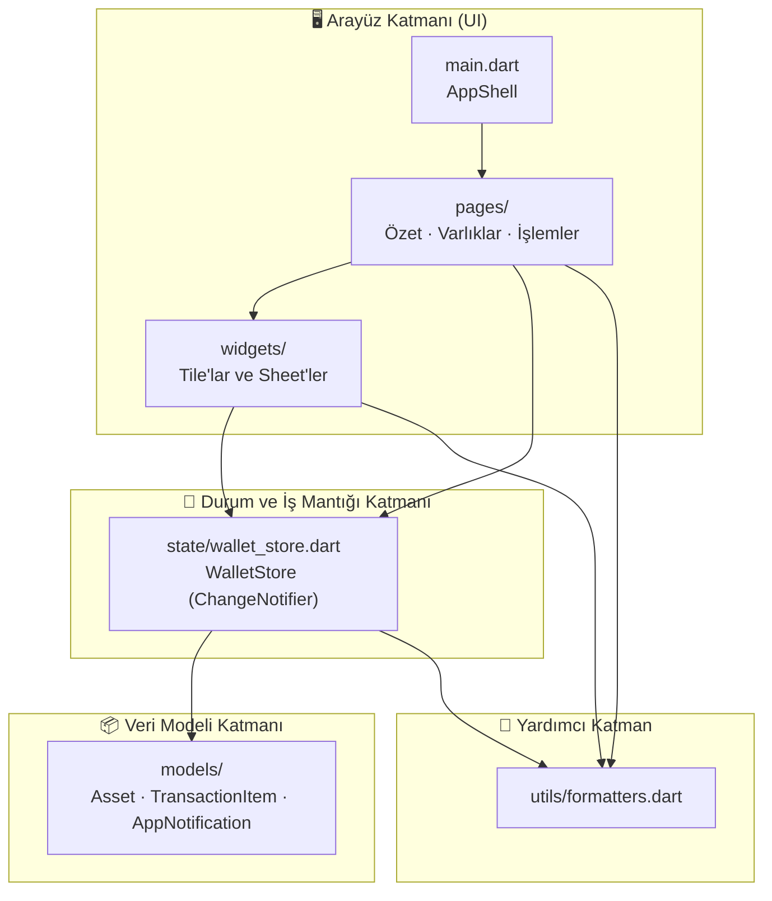
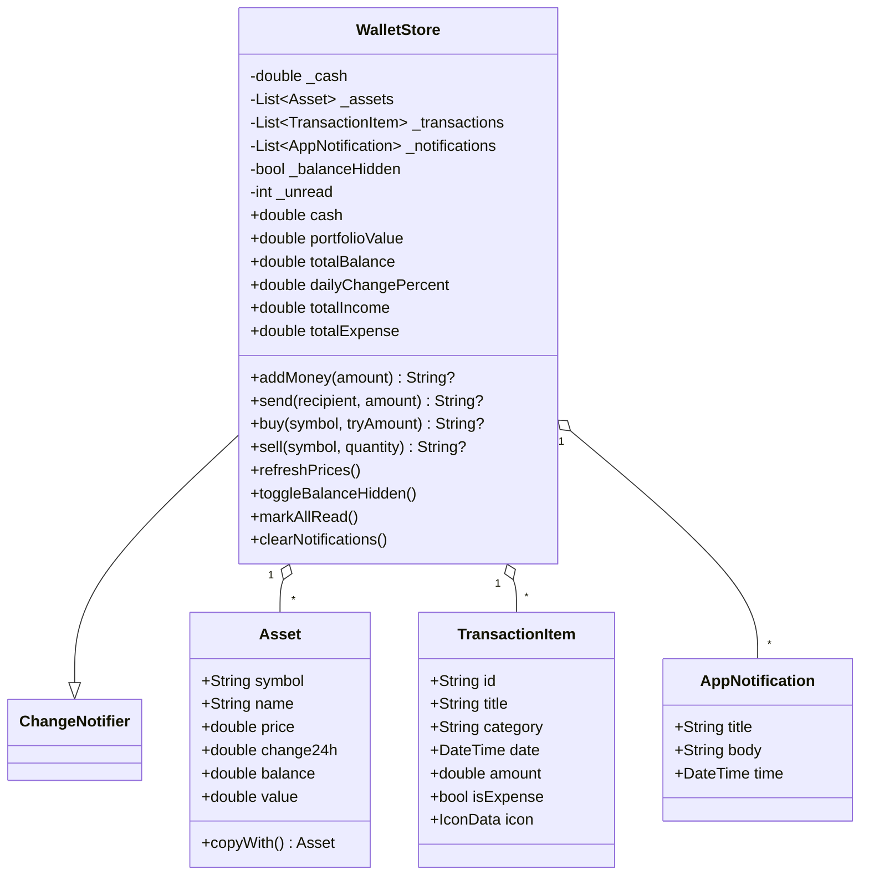
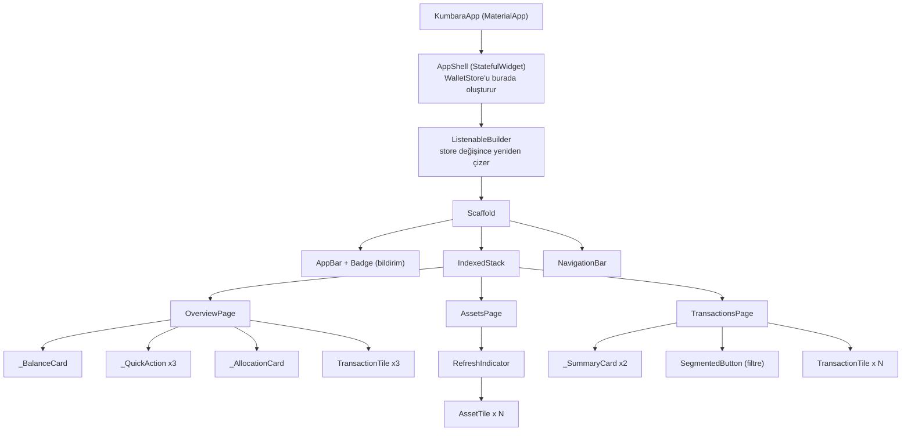
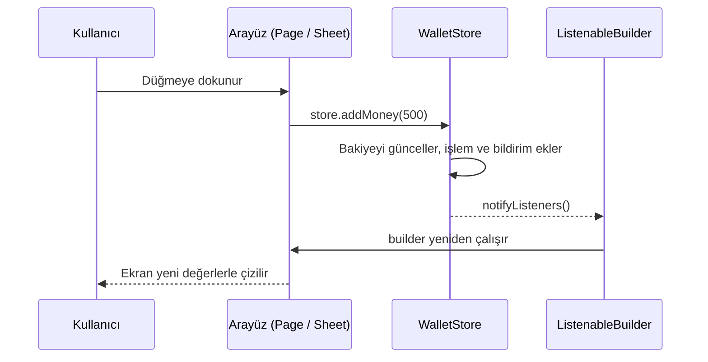
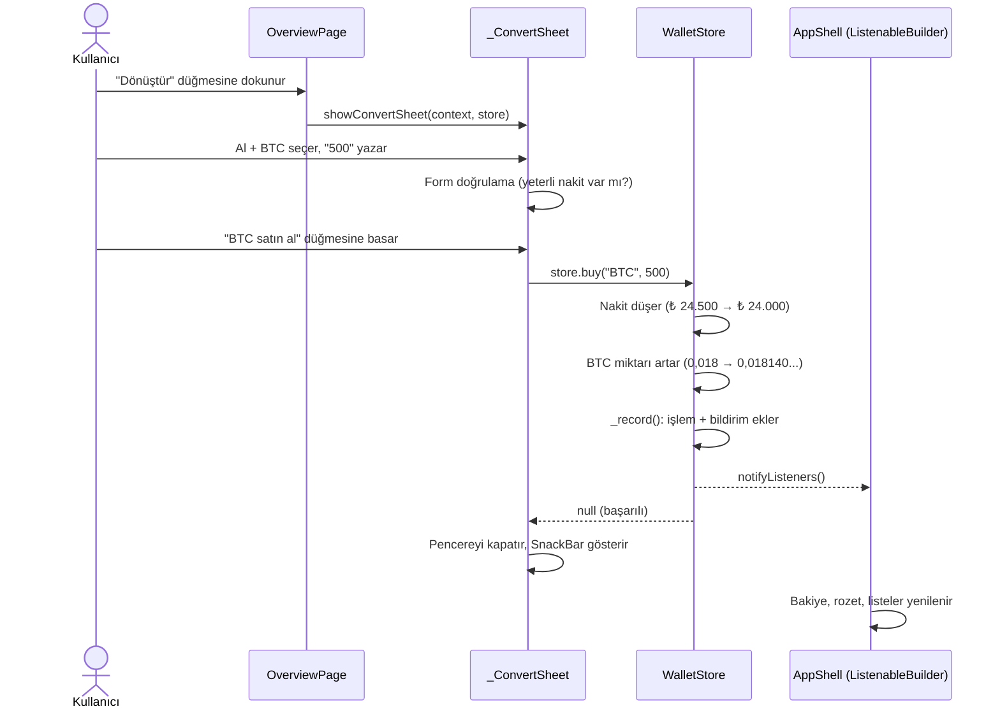
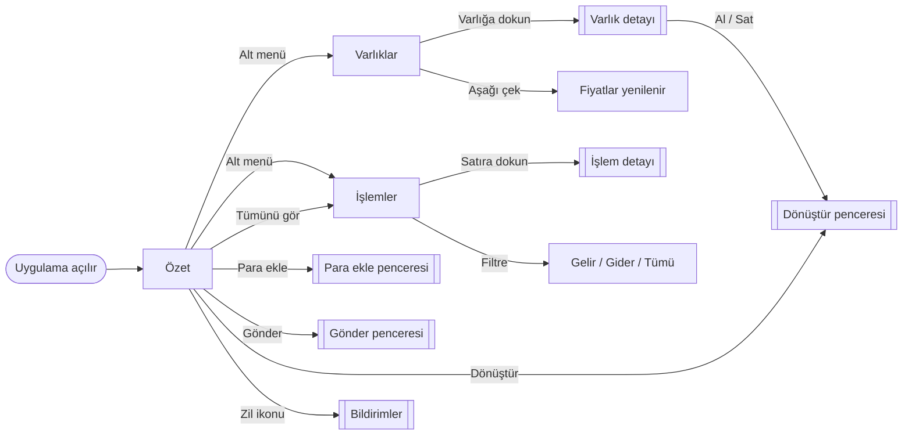

# 💼 Kumbara — Flutter Cüzdan Uygulaması Dokümantasyonu

> Üç sayfalı, sade ve tamamen çalışan bir kişisel cüzdan uygulaması.
> Nakit para, kripto varlıklar (BTC, ETH, USDT), işlem geçmişi ve bildirimler tek bir uygulamada.

---

## İçindekiler

1. [Projeye Genel Bakış](#1-projeye-genel-bakış)
2. [Özellikler](#2-özellikler)
3. [Kurulum ve Çalıştırma](#3-kurulum-ve-çalıştırma)
4. [Klasör Yapısı](#4-klasör-yapısı)
5. [Mimari](#5-mimari)
6. [Dosya Dosya Açıklama](#6-dosya-dosya-açıklama)
7. [Veri Akışı: Bir İşlem Baştan Sona Nasıl İlerler?](#7-veri-akışı-bir-işlem-baştan-sona-nasıl-ilerler)
8. [İş Kuralları ve Doğrulamalar](#8-iş-kuralları-ve-doğrulamalar)
9. [Ekranlar ve Kullanıcı Akışı](#9-ekranlar-ve-kullanıcı-akışı)
10. [Tasarım Kararları (Neden Böyle Yaptık?)](#10-tasarım-kararları-neden-böyle-yaptık)
11. [Bilinen Sınırlamalar](#11-bilinen-sınırlamalar)
12. [Geliştirme Önerileri](#12-geliştirme-önerileri)
13. [Test Örneği](#13-test-örneği)
14. [Sözlük](#14-sözlük)

---

## 1. Projeye Genel Bakış

**Kumbara**, kullanıcının nakit bakiyesini ve kripto varlıklarını tek bir ekranda görmesini, para ekleyip göndermesini, varlık alıp satmasını ve geçmiş işlemlerini incelemesini sağlayan bir mobil cüzdan uygulamasıdır.

| Bilgi | Değer |
|---|---|
| Platform | Flutter (Android / iOS / Web / Masaüstü) |
| Dil | Dart 3 |
| Arayüz | Material 3 |
| Durum yönetimi | `ChangeNotifier` + `ListenableBuilder` (ek paket yok) |
| Dış bağımlılık | Yok (sadece Flutter SDK) |
| Veri kaynağı | Bellekte tutulan örnek (demo) veri |
| Sayfa sayısı | 3 (Özet, Varlıklar, İşlemler) |

**Temel fikir:** Uygulamanın bütün verisi tek bir yerde (`WalletStore`) tutulur. Ekranlar sadece bu veriyi gösterir ve kullanıcıdan gelen istekleri `WalletStore`'a iletir. Veri değişince ekranlar kendiliğinden yenilenir.

---

## 2. Özellikler

### Özet sayfası
- Toplam bakiye kartı (nakit + varlıkların toplamı)
- 👁️ Bakiyeyi **gizle / göster** düğmesi
- Portföyün 24 saatlik değişim yüzdesi
- **Hızlı işlemler:** Para ekle, Gönder, Dönüştür
- **Dağılım çubuğu:** Bakiyenin nakit ve varlıklar arasındaki oranı
- **Son işlemler** listesi ve "Tümünü gör" kısayolu

### Varlıklar sayfası
- Toplam portföy değeri ve günlük değişim
- Varlık listesi (Bitcoin, Ethereum, Tether)
- **Aşağı çekerek yenileme** (fiyatlar simüle edilerek değişir)
- Varlığa dokununca **detay penceresi** ve oradan **Al / Sat** kısayolları

### İşlemler sayfası
- Toplam gelir ve toplam gider kartları
- **Tümü / Gelir / Gider** filtresi
- İşleme dokununca detay penceresi
- Filtre sonucu boşsa bilgilendirme mesajı

### Genel
- 🔔 Bildirim paneli (okunmamış sayısı rozetle gösterilir, "Temizle" düğmesi çalışır)
- Her başarılı işlem otomatik olarak işlem geçmişine ve bildirimlere eklenir
- Girdi doğrulama (boş, negatif, yetersiz bakiye vb.)
- Türkçe sayı ve tarih biçimi (`1.234,50`, `14 Ekim, 12:10`)

---

## 3. Kurulum ve Çalıştırma

### Gereksinimler
- Flutter SDK 3.x (Dart 3 ile birlikte gelir)
- Bir emülatör, fiziksel cihaz veya tarayıcı

### Adımlar

```bash
# 1. Yeni bir Flutter projesi oluştur (yoksa)
flutter create kumbara
cd kumbara

# 2. Verilen lib/ klasörünün içeriğini projedeki lib/ klasörüne kopyala
#    (varsayılan main.dart'ın üzerine yazılır)

# 3. Çalıştır
flutter run
```

> **Not:** `pubspec.yaml` içine ek paket eklemeye gerek yoktur. Proje yalnızca Flutter'ın kendi paketlerini kullanır.

---

## 4. Klasör Yapısı

```
lib/
├── main.dart                      ← Uygulamanın giriş noktası ve ana iskelet
│
├── models/                        ← Veri şablonları (sadece veri, mantık yok)
│   ├── asset_model.dart           ← Asset: kripto varlık
│   ├── transaction_model.dart     ← TransactionItem: bir cüzdan hareketi
│   └── app_notification.dart      ← AppNotification: bildirim kaydı
│
├── state/                         ← Uygulamanın "beyni"
│   └── wallet_store.dart          ← WalletStore: tüm veri ve iş kuralları
│
├── utils/                         ← Yardımcı fonksiyonlar
│   └── formatters.dart            ← Sayı/tarih biçimleme, girdi ayrıştırma
│
├── pages/                         ← Üç ana ekran
│   ├── overview_page.dart         ← Özet
│   ├── assets_page.dart           ← Varlıklar
│   └── transactions_page.dart     ← İşlemler
│
└── widgets/                       ← Tekrar kullanılan arayüz parçaları
    ├── asset_tile.dart            ← Varlık satırı + renk tanımları
    ├── transaction_tile.dart      ← İşlem satırı + detay penceresi
    └── action_sheets.dart         ← Para ekle / Gönder / Dönüştür / Bildirimler pencereleri
```

**Okuma sırası önerisi (yeni başlayan biri için):**
`models/` → `utils/formatters.dart` → `state/wallet_store.dart` → `widgets/` → `pages/` → `main.dart`

---

## 5. Mimari

Proje, birbirinden net ayrılmış **4 katmandan** oluşur. Her katman yalnızca bir altındaki katmanı bilir.

### 5.1 Katmanlı yapı



| Katman | Sorumluluk | Yapmaması gereken |
|---|---|---|
| **UI** (`main`, `pages`, `widgets`) | Ekranı çizmek, kullanıcı girişini almak | Bakiye hesaplamak, iş kuralı uygulamak |
| **State** (`WalletStore`) | Veriyi tutmak, kuralları uygulamak, değişimi duyurmak | Widget çizmek |
| **Model** (`models/`) | Verinin şeklini tanımlamak | Hesaplama yapmak (küçük getter'lar hariç) |
| **Utils** (`formatters`) | Biçimleme ve ayrıştırma | Uygulama durumuna dokunmak |

> Bu ayrım **SRP (Single Responsibility Principle — Tek Sorumluluk İlkesi)** örneğidir: her dosya yalnızca bir sebepten değişir.

### 5.2 Sınıf ilişkileri



### 5.3 Widget ağacı



### 5.4 Durum yönetimi nasıl çalışıyor?

Proje **ek paket kullanmadan** Flutter'ın yerleşik mekanizmasını kullanır:



1. `WalletStore`, `ChangeNotifier`'dan türer. Veri değişince `notifyListeners()` çağırır.
2. `AppShell` içindeki `ListenableBuilder`, store'u dinler. Bildirim gelince `builder` yeniden çalışır.
3. Sayfalar `store` nesnesini parametre olarak alır ve doğrudan okur. Bu yüzden bir sayfada yapılan değişiklik diğer sayfalara **anında** yansır.

**Neden `IndexedStack`?** Üç sayfa da bellekte yaşar. Sekmeler arasında gezinince filtre seçimi gibi sayfa içi durumlar kaybolmaz.

---

## 6. Dosya Dosya Açıklama

### 6.1 `main.dart`
| Sınıf | Görev |
|---|---|
| `KumbaraApp` | `MaterialApp`'i kurar: tema (zümrüt yeşili), başlık, ana sayfa |
| `AppShell` | Uygulamanın iskeleti. `WalletStore`'u **oluşturur ve yok eder** (`initState`/`dispose`), AppBar'ı, bildirim rozetini, sekmeleri ve alt gezinme çubuğunu yönetir |

### 6.2 `models/`
| Dosya | Sınıf | Alanlar |
|---|---|---|
| `asset_model.dart` | `Asset` | `symbol`, `name`, `price`, `change24h`, `balance`; hesaplanan `value` (= fiyat × miktar); `copyWith()` |
| `transaction_model.dart` | `TransactionItem` | `id`, `title`, `category`, `date` (DateTime), `amount`, `isExpense`, `icon` |
| `app_notification.dart` | `AppNotification` | `title`, `body`, `time` |

> Modeller **değiştirilemez (immutable)**'dir: tüm alanlar `final`. Bir varlığın miktarı değişecekse `copyWith()` ile yeni bir kopya üretilir. Bu, hataları azaltır ve Flutter'ın değişimi fark etmesini kolaylaştırır.

### 6.3 `state/wallet_store.dart` — Uygulamanın kalbi

**Tuttuğu veriler:** nakit bakiye, varlık listesi, işlem listesi, bildirim listesi, bakiye gizli mi, okunmamış bildirim sayısı.

**Hesaplanan değerler (getter):**

| Getter | Formül |
|---|---|
| `portfolioValue` | Σ (varlık fiyatı × miktarı) |
| `totalBalance` | `cash + portfolioValue` |
| `dailyChangePercent` | Σ (varlık değeri × 24s değişim) ÷ portföy değeri |
| `totalIncome` / `totalExpense` | Gelir / gider işlemlerinin toplamı |

**İşlem metotları:**

| Metot | Ne yapar | Hata durumları |
|---|---|---|
| `addMoney(amount)` | Nakite ekler, "Para yatırma" kaydı oluşturur | Tutar ≤ 0 |
| `send(recipient, amount)` | Nakitten düşer, "Transfer" kaydı oluşturur | Alıcı < 3 karakter, tutar ≤ 0, yetersiz bakiye |
| `buy(symbol, tryAmount)` | TL harcar, varlık miktarını artırır | Varlık yok, tutar ≤ 0, yetersiz nakit |
| `sell(symbol, quantity)` | Varlık miktarını azaltır, nakite ekler | Varlık yok, miktar ≤ 0, eldeki miktarı aşma |
| `refreshPrices()` | Fiyatları rastgele küçük oranda değiştirir (simülasyon) | — |
| `toggleBalanceHidden()` | Bakiye gizleme durumunu değiştirir | — |
| `markAllRead()` / `clearNotifications()` | Bildirim sayacını sıfırlar / listeyi temizler | — |

**Hata dönüş kuralı:** İşlem metotları `String?` döndürür.
- `null` → işlem **başarılı**
- Metin → işlem **başarısız**, metin kullanıcıya gösterilecek hata mesajıdır

Bu sayede arayüz, `try/catch` kullanmadan basitçe `if (error != null)` ile hatayı yakalar.

**Özel metot `_record(...)`:** Her başarılı işlemden sonra aynı üç işi yapar: (1) işlem listesinin başına yeni kayıt ekler, (2) bildirim ekler, (3) okunmamış sayacını artırıp `notifyListeners()` çağırır. Böylece her işlem metodunda aynı kod tekrarlanmaz (**DRY** ilkesi).

**Başlangıç verisi (demo):**

| Veri | Değer |
|---|---|
| Nakit | ₺ 24.500,00 |
| Bitcoin | 0,018 BTC (fiyat ₺ 3.562.000) |
| Ethereum | 0,76 ETH (fiyat ₺ 126.400) |
| Tether | 425 USDT (fiyat ₺ 34,20) |
| İşlemler | 4 örnek kayıt (tarihler uygulama açılış anına göre hesaplanır) |

### 6.4 `utils/formatters.dart`

| Fonksiyon | Ne yapar | Örnek |
|---|---|---|
| `formatNumber(value, decimals)` | Türkçe sayı biçimi (binlik nokta, ondalık virgül) | `1234.5` → `1.234,50` |
| `formatTry(value)` | Başına `₺` ekler | `₺ 1.234,50` |
| `formatDate(date)` | Bugün / Dün / gün-ay biçimi | `Bugün, 10:32`, `14 Ekim, 12:10` |
| `parseAmount(text)` | Kullanıcının yazdığını sayıya çevirir | `"1.500,50"` → `1500.5`, `"0.018"` → `0.018` |
| `validateAmount(text)` | Form alanı doğrulayıcısı | Boş/geçersiz/≤0 için hata metni |
| `roundMoney(value)` | 2 ondalığa yuvarlar | `10.456` → `10.46` |

> `intl` paketi kullanılmadı; amaç projeyi bağımlılıksız ve sade tutmaktı.

### 6.5 `widgets/`

**`asset_tile.dart`**
- `cashColor`, `assetColor(symbol)`: BTC turuncu, ETH mor-mavi, USDT yeşil, nakit zümrüt. Dağılım çubuğu ve varlık avatarları aynı renkleri kullanır, böylece görsel tutarlılık sağlanır.
- `AssetTile`: Varlık satırı (ad, miktar, TL değeri, 24s değişim — yeşil/kırmızı).

**`transaction_tile.dart`**
- `TransactionTile`: İşlem satırı (gelir yeşil `+`, gider kırmızı `-`).
- `showTransactionDetail(context, item)`: İşlem no, kategori, tarih, tür ve tutarı gösteren diyalog.

**`action_sheets.dart`** — Kullanıcının işlem yaptığı alt pencereler:

| Fonksiyon | Pencere | İçerik |
|---|---|---|
| `showAddMoneySheet` | Para ekle | Tutar alanı, hazır tutar çipleri (100/500/1000/5000), üst limit ₺ 1.000.000 |
| `showSendSheet` | Gönder | Alıcı alanı, tutar alanı, kullanılabilir nakit bilgisi |
| `showConvertSheet` | Dönüştür | Al/Sat seçici, varlık seçici, "Tümü" düğmesi, canlı önizleme |
| `showNotificationsSheet` | Bildirimler | Bildirim listesi, "Temizle", boş durum mesajı |

Hepsi `_openSheet()` yardımcısını kullanır. Bu yardımcı klavye açılınca pencerenin yukarı kayması ve içeriğin kaydırılabilmesi gibi ortak davranışları tek yerde çözer.

### 6.6 `pages/`

**`overview_page.dart`** — `OverviewPage`, `_BalanceCard`, `_MiniStat`, `_QuickAction`, `_AllocationCard`. "Tümünü gör" davranışı, sekmeyi değiştirme yetkisi `AppShell`'de olduğu için `onSeeAll` **geri çağırım (callback)** ile dışarıdan verilir.

**`assets_page.dart`** — `AssetsPage`: `RefreshIndicator` ile aşağı çekme, `_openDetail` ile varlık detay penceresi. Elde olmayan varlıkta **Sat** düğmesi pasif olur.

**`transactions_page.dart`** — `TransactionsPage` (StatefulWidget): seçili filtre bu sayfanın kendi durumudur (`_TxFilter`). Filtre bir *arayüz tercihi* olduğu için `WalletStore`'a değil sayfaya aittir.

---

## 7. Veri Akışı: Bir İşlem Baştan Sona Nasıl İlerler?

**Örnek: Kullanıcı 500 TL'lik Bitcoin alıyor.**



**Adım adım:**

1. Kullanıcı düğmeye dokunur → `showConvertSheet` alt pencereyi açar.
2. Kullanıcı bilgileri girer → **form doğrulayıcıları** hatalı girişi anında yakalar.
3. "Satın al" → `store.buy()` çağrılır.
4. Store, **ikinci bir doğrulama** yapar (UI'a körü körüne güvenmez), veriyi günceller.
5. `_record()` işlem + bildirim ekler ve `notifyListeners()` çağırır.
6. Metot `null` döner → pencere kapanır, başarı mesajı gösterilir.
7. `ListenableBuilder` tüm ekranı yeni verilerle yeniden çizer.

---

## 8. İş Kuralları ve Doğrulamalar

### 8.1 Çift katmanlı doğrulama

| Katman | Amaç | Örnek |
|---|---|---|
| **Arayüz** (form validator) | Kullanıcıya **anında, alanın altında** geri bildirim | "Yetersiz nakit. Mevcut: ₺ 24.500,00" |
| **Store** (metot içi kontrol) | **Güvenlik ağı**: arayüz atlansa bile geçersiz işlem yapılamaz | `String?` hata mesajı |

### 8.2 Kural tablosu

| Kural | Değer |
|---|---|
| Para ekleme üst limiti | ₺ 1.000.000 / işlem |
| Alıcı bilgisi | En az 3 karakter |
| Tutar | 0'dan büyük olmalı |
| Para tutarı yuvarlama | 2 ondalık (`roundMoney`) |
| Satış | Eldeki miktardan fazla satılamaz |
| Bildirim saklama | En fazla 30 adet (eskiler silinir) |
| Fiyat simülasyonu | Her yenilemede ≈ ±%2 (USDT için ≈ ±%0,1) |

### 8.3 Kayan nokta (floating point) toleransları

Bilgisayarlar ondalıklı sayıları tam saklayamaz (`0.1 + 0.2 = 0.30000000000000004`). Bu yüzden:
- **Alımda:** İstenen tutar nakitten en fazla 0,01 TL fazlaysa tüm nakit kullanılır (son kuruş sorunu önlenir).
- **Satışta:** İstenen miktar eldekinden en fazla `1e-7` fazlaysa eldeki miktar kadar satılır.
- **"Tümü" düğmesi:** Değeri **aşağı yuvarlar** (`floor`), böylece "yetersiz bakiye" hatası çıkmaz.

### 8.4 Kullanıcı girdisinin ayrıştırılması (`parseAmount`)

| Kullanıcı yazar | Sonuç | Kural |
|---|---|---|
| `1500` | 1500 | Düz sayı |
| `1.500,50` | 1500,5 | Virgül varsa **nokta binlik ayırıcıdır**, virgül ondalıktır |
| `0.018` | 0,018 | Virgül yoksa **nokta ondalıktır** |
| `abc` | geçersiz | Klavye zaten sadece rakam, `.` ve `,` kabul eder |

---

## 9. Ekranlar ve Kullanıcı Akışı



### Düğme kontrol listesi

| Düğme | Konum | Beklenen davranış |
|---|---|---|
| 👁️ Göz | Özet · bakiye kartı | Tutarlar `₺ ••••••` olur, tekrar basınca görünür |
| Para ekle | Özet | Pencere açılır, geçerli tutarla bakiye artar |
| Gönder | Özet | Alıcı + tutar ister, yetersizse hata verir |
| Dönüştür | Özet | Al/Sat penceresi açılır |
| Tümünü gör | Özet | İşlemler sekmesine geçer |
| İşlem satırı | Özet / İşlemler | Detay diyaloğu açılır |
| 🔔 Zil | AppBar | Bildirim paneli açılır, rozet sıfırlanır |
| Temizle | Bildirim paneli | Tüm bildirimler silinir |
| Varlık satırı | Varlıklar | Detay penceresi açılır |
| Al / Sat | Varlık detayı | Dönüştür penceresi o varlıkla açılır |
| Aşağı çek | Varlıklar | Fiyatlar güncellenir |
| Tümü / Gelir / Gider | İşlemler | Liste filtrelenir |
| Tümü | Dönüştür penceresi | Alanı maksimum değerle doldurur |

---

## 10. Tasarım Kararları (Neden Böyle Yaptık?)

| Karar | Gerekçe |
|---|---|
| **Paket yok, `ChangeNotifier` kullanıldı** | Küçük bir proje için Provider/Riverpod/Bloc gereksiz karmaşıklık katardı. Yerleşik çözüm hem yeterli hem öğrenmesi kolay |
| **Tek `WalletStore`** | Bütün sayfalar aynı gerçek kaynağı (single source of truth) kullanır, veri tutarsızlığı oluşmaz |
| **Modeller immutable (`final` + `copyWith`)** | Beklenmedik değişiklikleri önler, hata ayıklamayı kolaylaştırır |
| **`String?` ile hata dönüşü** | Basit ve okunabilir. Başarılı = `null` |
| **`DateTime` ile tarih tutma** | Orijinal projede tarih `String` idi (`'Bugün, 10:32'`). Metin olarak tutulan tarih sıralanamaz ve zamanla yanlış kalır. Şimdi gösterim sırasında biçimlendirilir |
| **Bakiye hesaplanan değer** | Orijinalde toplam bakiye ve portföy değeri elle yazılmıştı ve birbiriyle tutmuyordu. Şimdi hep hesaplanır |
| **Mantık UI'dan ayrıldı** | `WalletStore`'da widget yok → arayüze ihtiyaç duymadan test edilebilir |
| **`IndexedStack`** | Sekmeler arası geçişte sayfa durumu korunur |
| **Geri çağırım (`onSeeAll`)** | Sayfa, sekme değiştirmeyi bilmez; sadece "Tümünü gör'e basıldı" der. Sayfalar arası bağımlılık azalır |
| **Aynı renk paleti her yerde** | `assetColor()` tek yerde tanımlı; avatar, dağılım çubuğu ve legend hep aynı rengi kullanır |
| **Yinelenen kod `_openSheet`'e toplandı** | Klavye boşluğu, kaydırma, tutma çubuğu gibi ortak davranış tek yerde |

---

## 11. Bilinen Sınırlamalar

- ⚠️ **Veri kalıcı değil.** Uygulama kapanınca bakiye ve işlemler başlangıç değerlerine döner (veri sadece bellekte).
- ⚠️ **Fiyatlar gerçek değil.** "Yenile" rastgele küçük değişimler üretir; gerçek bir borsa/API'ye bağlı değildir.
- ⚠️ **Kimlik doğrulama yok.** Giriş, şifre veya biyometrik koruma bulunmuyor.
- ⚠️ **Gerçek para hareketi yok.** "Gönder" ve "Para ekle" simülasyondur.
- ⚠️ **Tek para birimi (TL).**
- ⚠️ **Otomatik test yok** (örnek test aşağıda verilmiştir).
- ⚠️ **Tek dil.** Metinler koda gömülüdür (Türkçe), çoklu dil desteği yoktur.

---

## 12. Geliştirme Önerileri

| Öncelik | Öneri | Nasıl? |
|---|---|---|
| 🔴 Yüksek | **Kalıcı veri** | `shared_preferences` (basit) veya `sqflite` / `drift` (SQLite) |
| 🔴 Yüksek | **Gerçek fiyat verisi** | `dio` / `http` ile bir kripto fiyat API'sine bağlanıp `refreshPrices()`'ı değiştirmek |
| 🟠 Orta | **Test yazmak** | `WalletStore` için birim testleri, sayfalar için widget testleri |
| 🟠 Orta | **Kimlik doğrulama** | `local_auth` (parmak izi / yüz tanıma) |
| 🟠 Orta | **Çoklu dil** | `flutter_localizations` + `intl` |
| 🟡 Düşük | **Grafikler** | `fl_chart` ile fiyat geçmişi ve harcama grafikleri |
| 🟡 Düşük | **Koyu tema** | `ThemeData(brightness: Brightness.dark)` ve tema anahtarı |
| 🟡 Düşük | **Durum yönetimi geçişi** | Proje büyürse `Provider` / `Riverpod` |

**Mimari açıdan en kolay geçiş yolu:** Kalıcılık eklemek için `WalletStore`'un içine bir `Repository` soyutlaması eklemek yeterlidir. Arayüz katmanı hiç değişmez; bu, katmanlı yapının asıl faydasıdır.

```
UI  →  WalletStore  →  Repository (yeni)  →  SQLite / API
```

---

## 13. Test Örneği

`WalletStore` arayüzden bağımsız olduğu için kolayca test edilir. `test/wallet_store_test.dart`:

```dart
import 'package:flutter_test/flutter_test.dart';
import 'package:kumbara/state/wallet_store.dart'; // paket adını kendi projene göre değiştir

void main() {
  group('WalletStore', () {
    test('addMoney nakdi artırır ve işlem ekler', () {
      final store = WalletStore();
      final cashBefore = store.cash;
      final txBefore = store.transactions.length;

      final error = store.addMoney(500);

      expect(error, isNull);
      expect(store.cash, cashBefore + 500);
      expect(store.transactions.length, txBefore + 1);
    });

    test('send yetersiz bakiyede hata döner ve bakiyeyi değiştirmez', () {
      final store = WalletStore();
      final cashBefore = store.cash;

      final error = store.send('Ayşe Yılmaz', cashBefore + 1);

      expect(error, isNotNull);
      expect(store.cash, cashBefore);
    });

    test('buy nakdi düşürür ve varlık miktarını artırır', () {
      final store = WalletStore();
      final cashBefore = store.cash;
      final btcBefore =
          store.assets.firstWhere((a) => a.symbol == 'BTC').balance;

      final error = store.buy('BTC', 1000);

      expect(error, isNull);
      expect(store.cash, cashBefore - 1000);
      expect(
        store.assets.firstWhere((a) => a.symbol == 'BTC').balance,
        greaterThan(btcBefore),
      );
    });

    test('sell eldekinden fazla miktarı reddeder', () {
      final store = WalletStore();
      final error = store.sell('BTC', 999);
      expect(error, isNotNull);
    });

    test('toplam bakiye = nakit + portföy', () {
      final store = WalletStore();
      expect(store.totalBalance, store.cash + store.portfolioValue);
    });
  });
}
```

Çalıştırmak için: `flutter test`

---

## 14. Sözlük

| Terim | Anlamı |
|---|---|
| **Widget** | Flutter'da ekrandaki her parça (buton, yazı, liste…) |
| **StatelessWidget** | Kendi içinde değişen durumu olmayan widget |
| **StatefulWidget** | Kendi durumu olan ve `setState` ile yenilenebilen widget |
| **ChangeNotifier** | Değiştiğinde dinleyicilerini haberdar eden sınıf |
| **ListenableBuilder** | Bir `ChangeNotifier`'ı dinleyip değişince yeniden çizen widget |
| **Callback (geri çağırım)** | Bir widget'a "olay olunca bunu çalıştır" diye verilen fonksiyon |
| **Immutable** | Oluşturulduktan sonra değiştirilemeyen nesne |
| **Getter** | Parantezsiz çağrılan, hesaplama yapıp değer döndüren özellik |
| **Bottom sheet** | Ekranın altından yukarı açılan pencere |
| **SnackBar** | Ekranın altında kısa süre görünen bilgi mesajı |
| **Single source of truth** | Verinin tek bir yerde tutulması ilkesi |
| **SRP** | Single Responsibility Principle: her parçanın tek sorumluluğu olmalı |
| **DRY** | Don't Repeat Yourself: aynı kodu tekrarlama |
| **Null safety** | `?` işaretiyle bir değerin boş olup olamayacağını açıkça belirten Dart özelliği |
| **Mermaid** | Markdown içinde diyagram çizmeyi sağlayan metin tabanlı dil (GitHub'da otomatik görüntülenir) |

---

<p align="center"><i>Kumbara — Basit, anlaşılır ve genişletilebilir bir Flutter cüzdan örneği.</i></p>
