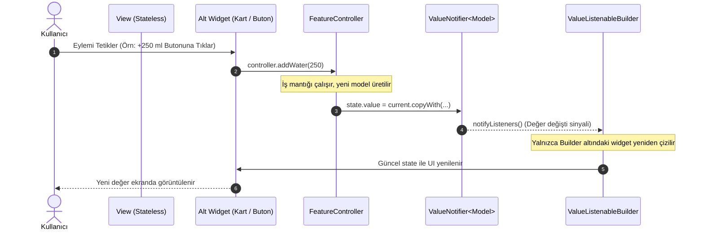

# Flutter Reaktif Durum Akışı (State Flow) Kılavuzu

Bu doküman, projede geliştirilen modüllerin ve ekranların **ValueNotifier tabanlı Reaktif Durum Yönetimi**, **Feature-Driven Mimari** ve **Temiz Kod (Clean Architecture)** prensiplerine tam uyumla çalışmasını sağlamak için hazırlanmış mimari referans kılavuzudur.

---

## 1. Mimari Genel Bakış ve Felsefe

Projede dış bağımlılık oluşturan ağır durum yönetimi paketleri (GetX, Bloc, Redux vb.) yerine; Dart ve Flutter'ın yerel, hafif ve yüksek performanslı çekirdek API'si olan **`ValueNotifier<T>`** ve **`ValueListenableBuilder<T>`** yapıları tercih edilir.

### Temel Hedefler:
- **Sıfır Ağır setState:** Sayfa düzeyinde komple `setState` çağrılarından kaçınarak yalnızca durumu değişen alt widget'ların yeniden çizilmesini (rebuild) sağlamak.
- **Sorumlulukların Ayrışması (Separation of Concerns):** 
  - `Model`: Veri yapısı, serileştirme ve değişmezlik (immutability).
  - `Controller`: İş mantığı, veri manipülasyonu ve bildirim mekanizması.
  - `View`: Ekran iskeleti, navigasyon ve alt bileşenlerin orkestrasyonu.
  - `Widgets`: 40 satırı aşmayan, tekrar kullanılabilir, saf görsel bileşenler.
- **Yüksek Performans ve Bellek Güvenliği:** Doğru `dispose` döngüsüyle bellek sızıntılarını (memory leak) önlemek ve statik widget'larda `const` kullanarak Flutter render optimizasyonunu en üst düzeye çıkarmak.

---

## 2. Reaktif Durum Akış Diyagramı (Mermaid)

Aşağıdaki şema, kullanıcı etkileşiminden arayüzün noktasal olarak güncellenmesine kadar geçen reaktif veri döngüsünü göstermektedir:



---

## 3. Katman Standartları ve İnce Detaylar

### A. Model Katmanı (`models/<feature_name>_model.dart`)
1. **İmmutability:** Model alanları mutlaka `final` olmalıdır. Nesne durumu doğrudan değiştirilemez; yeni bir kopya üretilmelidir.
2. **Const Constructor:** Derleme zamanı optimizasyonları için kurucu `const` olmalıdır.
3. **Standart Yardımcılar:** Her model mutlaka `copyWith`, `toJson` ve `fromJson` factory kurucusunu barındırmalıdır.
4. **Veri Güvenliği:** Sayısal dönüşümlerde `num.toInt()` ve `clamp` metotlarıyla sınır dışı (overflow / negatif) değerler engellenmelidir.

```dart
class WaterRecordModel {
  final int currentIntakeMl;
  final int dailyGoalMl;
  final int glassCount;
  final DateTime lastUpdated;

  const WaterRecordModel({
    required this.currentIntakeMl,
    required this.dailyGoalMl,
    required this.glassCount,
    required this.lastUpdated,
  });

  double get progressRatio =>
      dailyGoalMl > 0 ? (currentIntakeMl / dailyGoalMl).clamp(0.0, 1.0) : 0.0;

  WaterRecordModel copyWith({
    int? currentIntakeMl,
    int? dailyGoalMl,
    int? glassCount,
    DateTime? lastUpdated,
  }) {
    return WaterRecordModel(
      currentIntakeMl: currentIntakeMl ?? this.currentIntakeMl,
      dailyGoalMl: dailyGoalMl ?? this.dailyGoalMl,
      glassCount: glassCount ?? this.glassCount,
      lastUpdated: lastUpdated ?? this.lastUpdated,
    );
  }

  factory WaterRecordModel.fromJson(Map<String, dynamic> json) {
    return WaterRecordModel(
      currentIntakeMl: (json['currentIntakeMl'] as num?)?.toInt() ?? 0,
      dailyGoalMl: (json['dailyGoalMl'] as num?)?.toInt() ?? 2500,
      glassCount: (json['glassCount'] as num?)?.toInt() ?? 0,
      lastUpdated: json['lastUpdated'] != null
          ? DateTime.tryParse(json['lastUpdated'] as String) ?? DateTime.now()
          : DateTime.now(),
    );
  }

  Map<String, dynamic> toJson() => {
        'currentIntakeMl': currentIntakeMl,
        'dailyGoalMl': dailyGoalMl,
        'glassCount': glassCount,
        'lastUpdated': lastUpdated.toIso8601String(),
      };
}
```

---

### B. Controller Katmanı (`controllers/<feature_name>_controller.dart`)
1. **Notifier Kapsülleme:** Durum, `ValueNotifier<T>` örneği içerisinde tutulur.
2. **Saf Dart:** Controller içerisinde `BuildContext` ya da UI widget referansı **asla** bulunmamalıdır. Böylece Flutter framework'ünden bağımsız birim testleri (`unit test`) saniyeler içinde koşulabilir.
3. **Temizleme (Lifecycle):** Controller'da açılan her `ValueNotifier` için `dispose()` metodu yazılmalı ve dinleyiciler serbest bırakılmalıdır.

```dart
import 'package:flutter/foundation.dart';
import '../models/water_record_model.dart';

class WaterTrackerController {
  final ValueNotifier<WaterRecordModel> state = ValueNotifier<WaterRecordModel>(
    WaterRecordModel(
      currentIntakeMl: 0,
      dailyGoalMl: 2500,
      glassCount: 0,
      lastUpdated: DateTime.now(),
    ),
  );

  WaterRecordModel get current => state.value;

  void addWater(int amountMl) {
    if (amountMl <= 0) return;
    state.value = current.copyWith(
      currentIntakeMl: current.currentIntakeMl + amountMl,
      glassCount: current.glassCount + 1,
      lastUpdated: DateTime.now(),
    );
  }

  void resetWater() {
    state.value = current.copyWith(
      currentIntakeMl: 0,
      glassCount: 0,
      lastUpdated: DateTime.now(),
    );
  }

  void dispose() {
    state.dispose();
  }
}
```

---

### C. View Katmanı (`views/<feature_name>_view.dart`)
1. **Stateless Sorumluluk:** View sınıfı `StatelessWidget` olmalı ve dışarıdan `controller` nesnesini almalıdır.
2. **Noktasal Dinleme:** `ValueListenableBuilder` yalnızca durum değişiminden etkilenen widget bloğunu sarmalıdır.
3. **Kısa ve Okunaklı:** Ana sayfa hiyerarşisi sade kalmalı, alt görsel karmaşa `widgets/` altındaki sınıflara devredilmelidir.

```dart
import 'package:flutter/material.dart';
import '../controllers/water_tracker_controller.dart';
import '../models/water_record_model.dart';
import '../widgets/water_progress_card.dart';

class WaterTrackerView extends StatelessWidget {
  final WaterTrackerController controller;

  const WaterTrackerView({super.key, required this.controller});

  @override
  Widget build(BuildContext context) {
    return ValueListenableBuilder<WaterRecordModel>(
      valueListenable: controller.state,
      builder: (context, record, _) {
        return SingleChildScrollView(
          padding: const EdgeInsets.symmetric(horizontal: 16, vertical: 12),
          child: Column(
            children: [
              WaterProgressCard(record: record),
              const SizedBox(height: 16),
              // Alt kartlar buraya eklenir
            ],
          ),
        );
      },
    );
  }
}
```

---

### D. Alt Bileşenler (`widgets/<feature_name>_card.dart`)
1. **40 Satır Kuralı:** `build` metotları 40 satırı geçmemeli, karmaşık alt bölümler `_buildHeader()`, `_buildProgressRow()` gibi özel metotlara veya bağımsız `StatelessWidget` sınıflarına ayrılmalıdır.
2. **Tema Entegrasyonu:** Hardcoded renk kodları (`Color(0xFF...)`) yerine tema uzantıları (`context.accentWater`, `context.cardBackground` vb.) veya `Theme.of(context)` kullanılmalıdır.
3. **Const Zorunluluğu:** Değişmeyen tüm padding, SizedBox ve Text stillerinde `const` kullanılmalıdır.

---

## 4. Dikkat Edilmesi Gereken Kritik Noktalar

> [!IMPORTANT]
> **Bellek Yönetimi:** Bir controller bir `StatefulWidget` içerisinde oluşturuluyorsa (örneğin ana navigasyon ekranında), `State.dispose()` yaşam döngüsü metodunda mutlaka `controller.dispose()` çağrılmalıdır.

> [!WARNING]
> **Yasaklı Desen:** Bir `ValueNotifier.value` nesnesinin içindeki alanları doğrudan değiştirmek reaktif tetikleyiciyi (`notifyListeners`) çalıştırmaz. Durum güncellemesi DAİMA `state.value = state.value.copyWith(...)` şeklinde yeni bir referans atanarak yapılmalıdır.

> [!TIP]
> **Birim Testleri Kolaylığı:** Controller sınıflarında Flutter UI bileşeni bulunmadığı için test yazarken `testWidgets` yerine saf Dart `test()` fonksiyonu ile anlık durum geçişleri milisaniyeler içinde test edilebilir.

---

## 5. Doğrulama ve Kalite Standartları

Herhangi bir modül geliştirildikten sonra aşağıdaki standart komutlarla kod kalitesi teyit edilmelidir:

```bash
# 1. Sıfır hata ve sıfır uyarı kuralı:
flutter analyze

# 2. Tüm durum mantığı testlerinin başarıyla geçmesi:
flutter test
```
