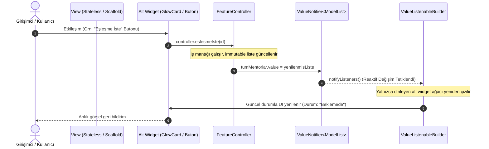
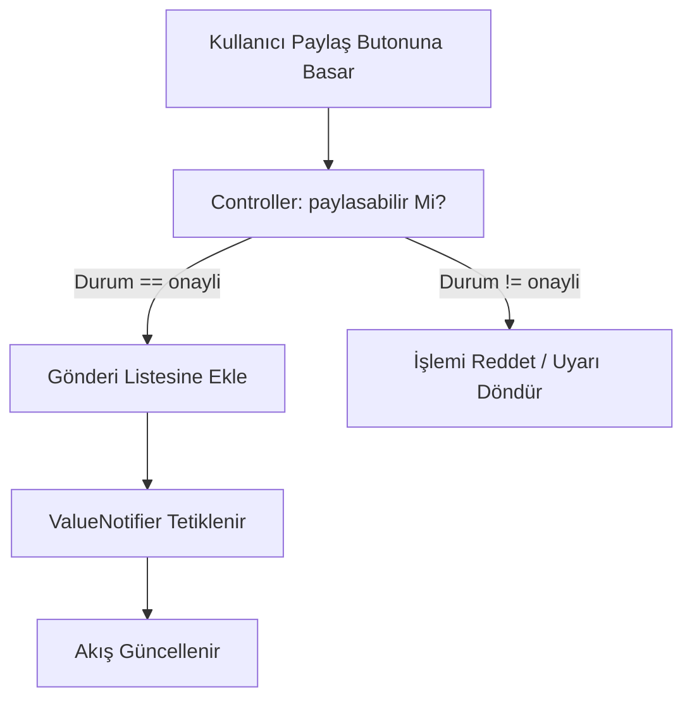

# Yörünge Reaktif Durum Akışı ve Mimari Kılavuzu (State Flow)

Bu doküman, **Yörünge Girişimcilik Platformu** kapsamında geliştirilen modül ve ekranların **ValueNotifier tabanlı Reaktif Durum Yönetimi**, **Feature-First Mimari** ve **Temiz Kod (Clean Architecture)** prensiplerine tam uyumla çalışmasını sağlamak amacıyla hazırlanmış teknik kılavuzdur.

---

## 1. Mimari Felsefe ve Kırmızı Çizgiler

Yörünge projesinde harici durum yönetimi paketleri (`provider`, `riverpod`, `flutter_bloc`, `get`/`getx`, `mobx`, `redux`) **kesinlikle yasaktır**. Durum yönetimi tamamen Dart ve Flutter'ın yerel çekirdek API'si olan:
- `ValueNotifier<T>`
- `ValueListenableBuilder<T>`
kombinasyonuyla yürütülür.

### Temel Hedefler:
1. **Sıfır Ağır setState:** Sayfa seviyesinde komple `setState` çağrılarından kaçınılır. Sadece durumu değişen alt widget'lar `ValueListenableBuilder` ile hedeflenerek noktasal olarak yeniden çizilir (rebuild).
2. **Katmanların Ayrışması (Separation of Concerns):**
   - `models/`: Değişmez (`immutable`), `const` kuruculu, `copyWith` ve `toJson`/`fromJson` metotlarına sahip veri sınıfları.
   - `data/`: Gerçek ağ istekleri yerine `project.md` standardında hazırlanmış `mock_<feature>_data.dart` sabitleri.
   - `controller/`: Saf Dart (`package:flutter/foundation.dart`). UI ve `BuildContext` bilmez, birim test edilebilir mantık ve durum bildirim mekanizması içerir.
   - `view/`: Ekran iskeleti (`Scaffold`, `AppBar`, `CustomScrollView`), alt bileşenlerin birleşimi ve sayfa seviyesi yaşam döngüsü.
   - `widget/`: 40 satırı aşmayan, tekrar kullanılabilir, temaya tam duyarlı alt görsel bileşenler.
3. **Hafıza Güvenliği:** Controller nesnelerindeki `ValueNotifier` dinleyicileri, ilgili ekranın `dispose()` anında mutlaka `controller.dispose()` çağrılarak bellekten temizlenir.

---

## 2. Reaktif Durum Akış Şeması



---

## 3. Özelliklere Özgü Durum Akışları

### A. Topluluk Yetki ve Akış Kontrolü
Topluluk ekranında paylaşım, beğeni ve yanıt hakları yalnızca başvurusu **Onaylandı** olan girişimcilere verilir. Bu kontrol arayüzde değil, controller katmanında uygulanır:



### B. Analiz (Stepper) Taslak ve Doğrulama Akışı
1. Kullanıcı 8 adımlı testte ilerlerken her adımın cevapları `ValueNotifier<BolumCevaplari>` içinde tutulur.
2. Adım doğrulanmadan "İleri" butonu aktifleşmez.
3. Ara adımlarda taslak verisi `shared_preferences` kullanılarak yerel olarak yedeklenir.
4. Tamamlandığında durum `fikir_durumu` modülüne aktarılır.

### C. Tema Yönetimi Akışı (`ThemeController`)
- `ThemeController` çekirdekte `ValueNotifier<ThemeMode>` barındırır.
- Kullanıcı AppBar üzerindeki tema değiştiriciye dokunduğunda:
  ```dart
  themeMode.value = isDark ? ThemeMode.light : ThemeMode.dark;
  ```
- `MaterialApp` kök seviyesinde `ValueListenableBuilder` ile sarılıdır; tüm uygulama anında ve akıcı şekilde "Derin Uzay" ve "Şafak Fırlatışı" temaları arasında geçiş yapar.

---

## 4. Kod Standartları ve Kontrol Listesi
- [ ] Modeller `const` constructor ve `final` alanlara sahip mi?
- [ ] Controller'da `BuildContext` kullanmaktan kaçınıldı mı?
- [ ] `build` metotları 40 satır sınırına uyuyor mu?
- [ ] Statik widget'lar `const` ile işaretlendi mi?
- [ ] Renkler doğrudan kodlanmak yerine `context.spaceColors` üzerinden mi çekildi?
- [ ] Controller'ın `dispose()` metodu çağrılıyor mu?
- [ ] `await` işlemlerinden sonra `if (!context.mounted) return;` kontrolü eklendi mi?
